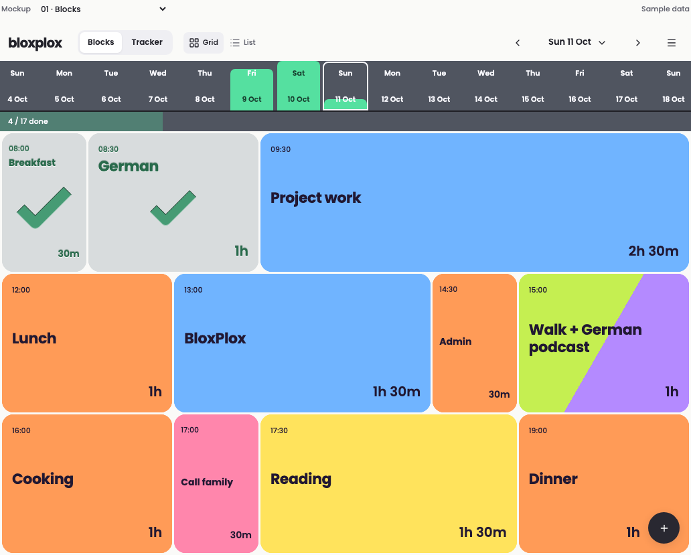

# BloxPlox

Daily blocks and habit tracking, with a shared history and one Grid/List setting.

This repository contains the interactive prototype approved during the design conversation, its sample data and assets, browser checks, and the implementation handoff. **It is a prototype: edits are held in memory and reset on reload.** The React application, AWS infrastructure, authentication, and synchronization have not been implemented or deployed.



## Run locally

Use Node.js 22 or newer and Yarn 4.18.1. Yarn is configured with `nodeLinker: node-modules`.

```sh
corepack enable
yarn install --immutable
yarn dev
```

Open <http://127.0.0.1:4173>. If Corepack is not supplied by your Node installation, install Corepack or Yarn 4 first. Set `PORT` to use a different port.

You can also open `apps/prototype/index.html` directly in a modern browser. Fonts and icons are bundled locally; the prototype makes no backend requests. The sample day is fixed at **11 October 2026** for repeatable review.

The **Mockup** selector opens the different screens. **Blocks** and **Tracker** switch between the two main views; **Grid/List** applies to both. Swipe right to complete, left to mark not done, or repeat the same direction to clear. Press and hold a block to move it; on desktop, a grip appears on hover/focus. Tap a block for its settings and actions.

## Repository layout

```text
apps/prototype/         Standalone HTML, CSS and JavaScript prototype
  assets/fonts/         Poppins 500, 600 and 700
  assets/vendor/        Pinned Lucide browser bundle and license
design/archive/        Exact original concept fragments (v1 and final v2)
design/screenshots/    Selected design review captures
docs/product.md        Accepted behaviour and interaction details
docs/architecture.md   Requested production architecture; pending decisions
docs/handoff.md        What exists, limitations, references and next steps
samples/               Export of the initial sample state
scripts/               Local server, static build and browser-test runner
tests/                 Portable Playwright interaction checks
licenses/              Third-party asset notices
```

`apps/prototype` is the runnable source. Archived fragments preserve the original Codex artifacts and may need a host-provided icon runtime; use the standalone prototype for review. The current code is deliberately kept as the working HTML/CSS/JavaScript prototype, ready to port to the exact React stack once `omni-studio` is located.

## Check and build

```sh
yarn test:install
yarn test
yarn build
```

Tests start a temporary localhost server and run Chromium. They cover swipe directions and clearing, completion/history aggregation, linking, recurrence, resizing, mouse/touch/keyboard rearrangement, history scrolling, and responsive screens. Screenshots are written to ignored `test-results/`. An existing Chromium binary can be selected with `PLAYWRIGHT_CHROMIUM_EXECUTABLE_PATH`.

`yarn build` copies the standalone prototype to `dist/`. This is a static review build, not an AWS deployment. `yarn samples:export` refreshes `samples/initial-state.json` from the literals in `app.js`.

## Production direction

- React using the same stack as `omni-studio`.
- TypeScript Lambda functions, API Gateway HTTP and WebSocket APIs.
- RxDB local persistence and replication; DynamoDB as the server datastore.
- DynamoDB Streams trigger updates to connected clients.
- Cognito authentication and per-user data isolation.
- AWS Amplify Hosting, with backend and hosting infrastructure defined in TypeScript CDK.
- Existing Route53 zone; exact domain, AWS account/profile and region still to be supplied.

See [architecture](docs/architecture.md) and [handoff](docs/handoff.md) for the detailed implementation plan and verified reference revision. No AWS resources have been created by this handoff.

## Continue on the MacBook Pro

The intended working directory is `~/Orgs/BloxPlox`:

```sh
mkdir -p ~/Orgs
git clone git@github.com:DustyLamp/bloxplox.git ~/Orgs/BloxPlox
cd ~/Orgs/BloxPlox
yarn install --immutable
yarn dev
```

Use the HTTPS clone URL if SSH is not configured. This initial handoff was assembled in a temporary checkout on the Mac mini.

See [third-party notices](licenses/README.md) for asset attribution. No license has yet been selected for the BloxPlox application source.
