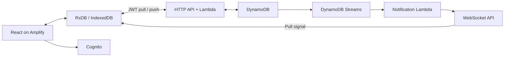

# Production architecture

React 19, TypeScript, Vite, TanStack Router, Tailwind, Lucide, Zod, RxDB 17.6 and Dexie. Yarn uses `node-modules`. The exact lockfile is used in local, GitHub and CodeBuild builds. The frontend and replication conventions were checked against the requested current reference sources; no private implementation is vendored.

## Ownership and storage

Cognito subjects own separate DynamoDB partitions and separate hashed RxDB database names. The server verifies an access token and derives ownership; requests cannot name a user or partition. Password sign-in uses Cognito SRP. Signup, code verification/resend, forgotten password, session refresh and sign-out are implemented.

A conditional DynamoDB transaction writes a document, increments its owner's sequence, and appends an immutable change entry. Strongly consistent pull queries consume this sequence, deduplicate a batch, and return a durable checkpoint. Changes and tombstones are retained, so a long-offline client can catch up. PITR and deletion protection protect application data. The connection table has TTL.

Push carries proposed and assumed master documents. A stale revision returns the master. The RxDB conflict handler merges independent fields using logical clocks and stable device IDs. Timing, recurrence and completion are atomic fields. Concurrent same-field writes converge deterministically; there is no device wall-clock dependency. Explicit deletion wins over an ordinary edit; Undo makes a later restoration. Forms write only changed fields. Open block, habit and Thing editors refresh untouched fields when remote changes arrive while preserving unsaved local edits. A stale block editor cannot restore a remotely deleted block by saving.

## Notifications and recovery

An authenticated HTTP request issues a single-use, 60-second WebSocket ticket. Only its hash is stored. A connection has the same expiry as its access token; heartbeats enforce expiry. Streams notify only the owning user's connections. Notifications contain no application data.

The client pulls on connection, notification, focus, online transition, and every minute as a recovery path. It sends heartbeats, closes stale sockets, retries with bounded exponential backoff, and obtains fresh authentication on reconnect. Push/pull retries survive unavailable networks. Sign-out aborts requests, closes sockets/subscriptions, and closes the local database. Unsent changes remain in that account's database for its next sign-in.

## Calendar and history

This is a calendar planner: dates and times are local wall-clock values, not UTC appointments. The global schedule timezone determines Today, rollover and reminder times. Changing timezone keeps blocks at their clock time. A recurrence stores its creation timezone as provenance; daylight-saving changes never skip or duplicate its calendar date. Overnight work uses one block per date, ending at midnight where needed.

A series has stable occurrence IDs even when its rule is versioned. Editing a recurrence from a later day ends the earlier version and starts a new version, retaining the original interval anchor. Saved, moved, backlogged and deleted exceptions suppress generation. Viewing a day writes nothing. Completion freezes scheduled instances so history retains their duration/categories. Linked habits and blocks use one result identity.

History derives from actual records. Category time divides a completed block's duration equally across its categories. Deactivated habits retain recorded results; unrecorded dates follow the current habit weekday settings. Numeric values, explicit not-done and skip are separate states.

Things are independent, non-recurring documents. Blocks optionally reference their IDs, and completion is a nullable calendar date on the Thing itself. This keeps a task's completion shared across sessions while a block's result measures its session separately. Rename/notes and completion merge independently. Task deletion hides it from every checklist without deleting sessions; session deletion leaves tasks intact. Recurring sessions never automatically copy one-off task references into future occurrences.

## Delivery and operation

The CDK pipeline uses a GitHub source secret, CodeBuild tests and synthesis, a production stage, and a post-deployment Amplify publish step. It is self-mutating. The app stack defines Cognito, DynamoDB, Lambda, HTTP/WebSocket APIs, Streams handling, a dead-letter queue/alarm, Amplify hosting, and the Route53-managed custom-domain association. HTTP and WebSocket stages have throttles. CSP restricts network/script origins; fonts are local.

The generated service worker caches the application shell and runtime configuration, never authenticated API responses. After the first online load, an already signed-in account can reopen and edit offline. A waiting update activates when the old app tabs close. Browser data clearing removes unsent changes; Export data is available in Settings.

Pinned CDK versions (registry checked 2026-10-11): library 2.273.0 and CLI 2.1145.0. The different version numbers are intentional. RxDB schema version 0 stores an extensible record envelope; adding Things and optional block references preserves that envelope and all existing records. Changes to the storage envelope require RxDB migrations without resetting local storage.

Open-app reminders are supported; closed-app push/email reminders are not scheduled. DynamoDB change-log retention is currently indefinite. Monitor table growth and notification dead letters before introducing retention or compaction.

## Mobile and shared code

Expo / React Native uses native screens and gestures. `packages/auth`, `packages/domain`, and `packages/sync` contain platform-neutral authentication, validated records, conflict resolution, scheduling, and replication. Browser RxDB uses Dexie. Native RxDB uses the free local-storage engine with a synchronous SQLite adapter; one native process owns each account-specific database. Serialized transactions roll back documents and indexes together and emit change events only after commit. Tests reopen hundreds of persisted records and simulate storage failure.

The prerequisite canvas is shared React Flow code rendered by Expo DOM from bundled assets. It needs no hosted graph page or network connection. Native screens expose the same graph actions as accessible buttons and lists.

Cognito authorization-code flows use PKCE, one-use state and a nonce, with token exchange at the configured Cognito HTTPS endpoint. The pre-signup trigger links trusted Google/Apple verified-email identities to one local profile. It refuses unverified or ambiguous matches. Its IAM policy is restricted to this account, region and tagged production BloxPlox pools, avoiding a CloudFormation dependency cycle between the pool and its trigger.

## Calendar import

Google OAuth refresh credentials stay in private server-owned DynamoDB items and are excluded from RxDB replication. The OAuth client secret is in Secrets Manager. Calendar-list and event scopes are read-only; user-facing hide and merge actions only write BloxPlox records. Clients cannot push imported sources/events.

SQS serializes small import jobs with at most two worker invocations running concurrently. Google watch notifications use unpredictable channel secrets. A daily catch-up renews watches; app foreground, reconnect and a five-minute foreground timer request catch-up. There is no minute-by-minute scan of an empty table. The daily job queries a sparse integration index.

Each import fetches every Google page for a bounded view window (31 days before through 184 days after the selected date), with recurring exceptions expanded by Google. Older imported history is retained. Only a complete successful snapshot can remove missing events. Long first imports enqueue continuations; already-applied records are skipped and partial imports never prune. Auth failures retain the offline copy and ask the user to reconnect.

## Paid access remains disabled

CDK sets `PAID_PLANS_ENABLED=false`; client release policy grants every feature regardless of cached billing state. No Stripe reads or habit admission limits run while disabled. Stripe integration code remains available for the later agreed launch, with server-owned prices, signed webhooks, idempotent checkout, and account-owned customer records.
