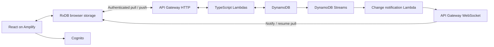

# Production architecture — requested, not implemented

## Required stack

| Layer | Requirement |
| --- | --- |
| Frontend | React and the exact `omni-studio` stack; source location pending |
| Local data | RxDB, persisted in the browser |
| Backend | TypeScript Lambda functions |
| APIs | API Gateway HTTP for pull/push; WebSockets for live change notifications |
| Server data | DynamoDB |
| Change delivery | DynamoDB Streams → Lambda → authenticated WebSocket clients |
| Authentication | Cognito; sign-up audience pending |
| Hosting | AWS Amplify Hosting |
| Infrastructure | TypeScript AWS CDK, including backend and Amplify resources |
| DNS | Existing Route53 zone; exact domain and account to be confirmed |
| Tooling | Yarn with `nodeLinker: node-modules` |



## Reference inspected

`inside-labs/omni-domain-replication`, latest fetched `main` on 2026-10-11:

- Commit: [`2afbc075a0e7f700c56fa1541207cfe9cc2e0670`](https://github.com/inside-labs/omni-domain-replication/commit/2afbc075a0e7f700c56fa1541207cfe9cc2e0670) (2026-09-24).
- Client package version: `@inside-labs/replication-client` 0.0.26, using RxDB `^17.1.0`, RxJS, and Dexie.
- `replication.ts` uses `replicateRxCollection` with pull checkpoints, push batches, conflict responses, and a live stream.
- `websocket.ts` sends heartbeats, retries with backoff, and emits `RESYNC` after reconnect/change notifications.
- The latest source includes Cognito access-token verification and partition-aware connection authentication. Some README notes still describe an older unauthenticated proof of concept; review the actual code when implementing.

The private reference repository and its internal package sources are not vendored in this public repository. Use it as an architectural reference in an authorized development environment.

## Sync requirements to implement and verify

1. Writes succeed locally and queue for replication while offline.
2. Authenticate HTTP and WebSocket access with Cognito; derive data ownership server-side. Never trust a client-supplied user partition.
3. Use durable, ordered pull checkpoints and tombstones so offline devices catch up correctly. Test ordering, pagination, retries, deletions, and duplicate stream events.
4. Make push conflicts explicit and protect concurrent updates with conditional writes. Choose a documented policy for edits to the same block on different devices; reference timestamp-based conflict handling requires review for personal schedules.
5. WebSockets notify clients to pull; persistent DynamoDB data provides recovery when a connection or stream notification is lost.
6. Reconnect with a fresh authentication token, heartbeat while open, and pull from the persisted checkpoint on resume. API Gateway has a two-hour connection limit and ten-minute idle timeout ([AWS quotas](https://docs.aws.amazon.com/apigateway/latest/developerguide/apigateway-execution-service-websocket-limits-table.html)).
7. Keep scheduled occurrences stable across clients, preserve per-occurrence exceptions, and use a single logical result for linked habits/blocks. Store the user's timezone and apply local-time recurrence rules across daylight-saving changes.
8. Version RxDB schemas and migrate them without wiping unsynced user edits. Verify sign-out and account switching isolate local data.

## Suggested production directory layout

```text
apps/web/              React application after matching omni-studio
packages/domain/       Shared schemas, recurrence and schedule behaviour
packages/sync/         RxDB client adapter and shared sync contracts
services/functions/   TypeScript Lambda entry points
infrastructure/       TypeScript CDK application and stacks
```

These directories are proposed, not empty placeholder implementations. The prototype remains in `apps/prototype/` until ported.

## Versions and deployment decisions

Registry versions checked on 2026-10-11: `aws-cdk-lib` 2.273.0, CDK CLI `aws-cdk` 2.1145.0, RxDB 17.6.0. Recheck stable releases when implementing CDK; library and CLI version numbers differ. These are planning notes, not installed production dependencies.

Still needed: AWS account/profile and region, exact production hostname/hosted zone, `omni-studio` location, and invite-only versus public signup. Cognito sign-in details are delegated to the implementation; email sign-in is the suggested initial flow. GitHub/Amplify integration and runtime configuration should be provisioned without checking credentials into the repository.

No CDK stacks, Cognito pools, DynamoDB tables, API deployments, Amplify apps, or Route53 changes have been created.
