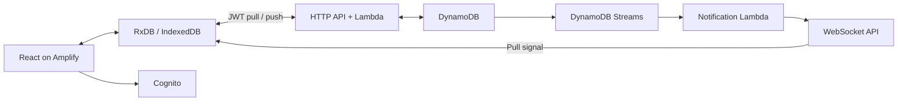

# Production architecture

React 19, TypeScript, Vite, TanStack Router, Tailwind, Lucide, Zod, RxDB 17.6 and Dexie. Yarn uses `node-modules`. The exact lockfile is used in local, GitHub and CodeBuild builds. The frontend and replication conventions were checked against the requested current reference sources; no private implementation is vendored.

## Ownership and storage

Cognito subjects own separate DynamoDB partitions and separate hashed RxDB database names. The server verifies an access token and derives ownership; requests cannot name a user or partition. Password sign-in uses Cognito SRP. Signup, code verification/resend, forgotten password, session refresh and sign-out are implemented.

A conditional DynamoDB transaction writes a document, increments its owner's sequence, and appends an immutable change entry. Strongly consistent pull queries consume this sequence, deduplicate a batch, and return a durable checkpoint. Changes and tombstones are retained, so a long-offline client can catch up. PITR and deletion protection protect application data. The connection table has TTL.

Push carries proposed and assumed master documents. A stale revision returns the master. The RxDB conflict handler merges independent fields using logical clocks and stable device IDs. Timing, recurrence and completion are atomic fields. Concurrent same-field writes converge deterministically; there is no device wall-clock dependency. Explicit deletion wins over an ordinary edit; Undo makes a later restoration. Forms write only fields changed since they opened.

## Notifications and recovery

An authenticated HTTP request issues a single-use, 60-second WebSocket ticket. Only its hash is stored. A connection has the same expiry as its access token; heartbeats enforce expiry. Streams notify only the owning user's connections. Notifications contain no application data.

The client pulls on connection, notification, focus, online transition, and every minute as a recovery path. It sends heartbeats, closes stale sockets, retries with bounded exponential backoff, and obtains fresh authentication on reconnect. Push/pull retries survive unavailable networks. Sign-out aborts requests, closes sockets/subscriptions, and closes the local database. Unsent changes remain in that account's database for its next sign-in.

## Calendar and history

This is a calendar planner: dates and times are local wall-clock values, not UTC appointments. The global schedule timezone determines Today, rollover and reminder times. Changing timezone keeps blocks at their clock time. A recurrence stores its creation timezone as provenance; daylight-saving changes never skip or duplicate its calendar date. Overnight work uses one block per date, ending at midnight where needed.

A series has stable occurrence IDs even when its rule is versioned. Editing a recurrence from a later day ends the earlier version and starts a new version, retaining the original interval anchor. Saved, moved, backlogged and deleted exceptions suppress generation. Viewing a day writes nothing. Completion freezes scheduled instances so history retains their duration/categories. Linked habits and blocks use one result identity.

History derives from actual records. Category time divides a completed block's duration equally across its categories. Deactivated habits retain recorded results; unrecorded dates follow the current habit weekday settings. Numeric values, explicit not-done and skip are separate states.

## Delivery and operation

The CDK pipeline uses a GitHub source secret, CodeBuild tests and synthesis, a production stage, and a post-deployment Amplify publish step. It is self-mutating. The app stack defines Cognito, DynamoDB, Lambda, HTTP/WebSocket APIs, Streams handling, a dead-letter queue/alarm, Amplify hosting, and the Route53-managed custom-domain association. HTTP and WebSocket stages have throttles. CSP restricts network/script origins; fonts are local.

The generated service worker caches the application shell and runtime configuration, never authenticated API responses. After the first online load, an already signed-in account can reopen and edit offline. A waiting update activates when the old app tabs close. Browser data clearing removes unsent changes; Export data is available in Settings.

Pinned CDK versions (registry checked 2026-10-11): library 2.273.0 and CLI 2.1145.0. The different version numbers are intentional. Schema version 0 is the initial production schema; future data changes must add RxDB migrations without resetting local storage.

Open-app reminders are supported; closed-app push/email reminders are not scheduled. DynamoDB change-log retention is currently indefinite. Monitor table growth and notification dead letters before introducing retention or compaction.
